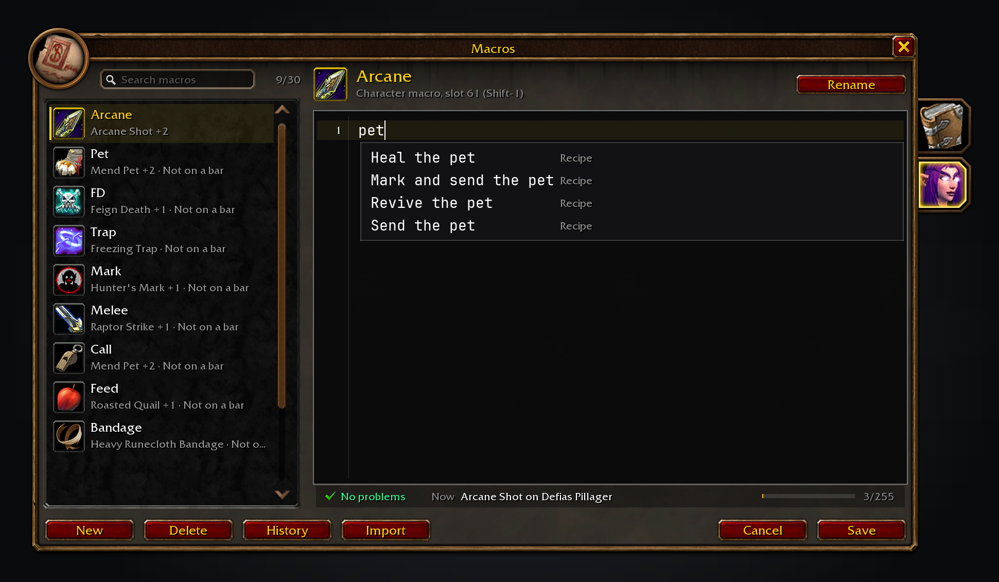
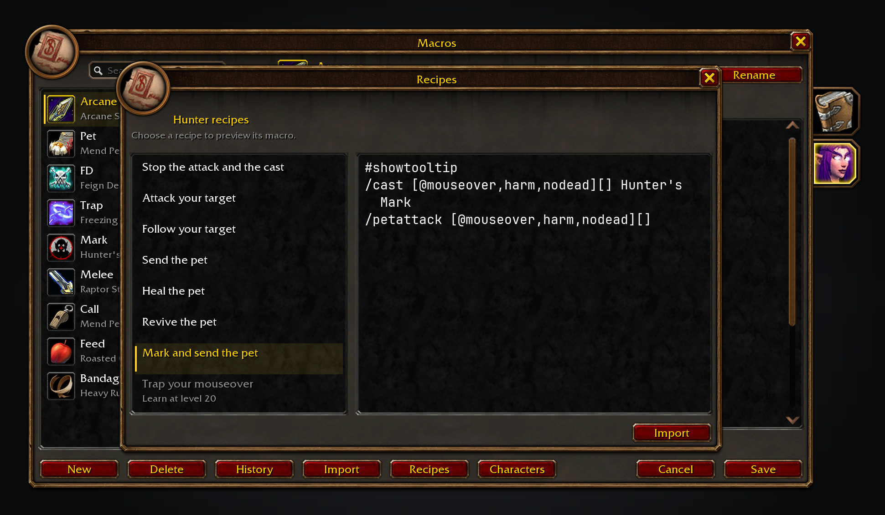
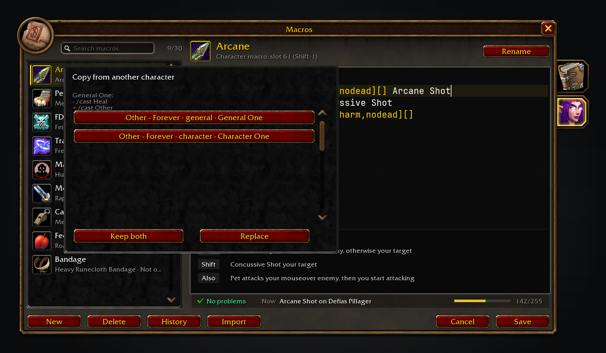
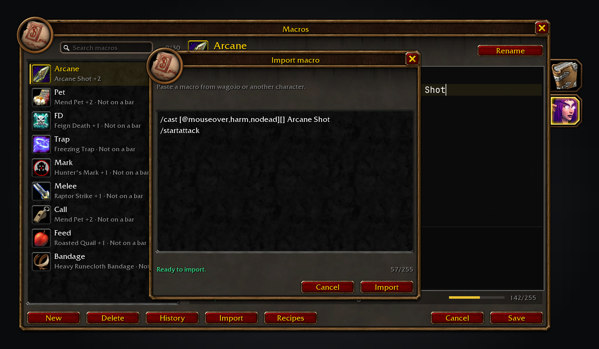
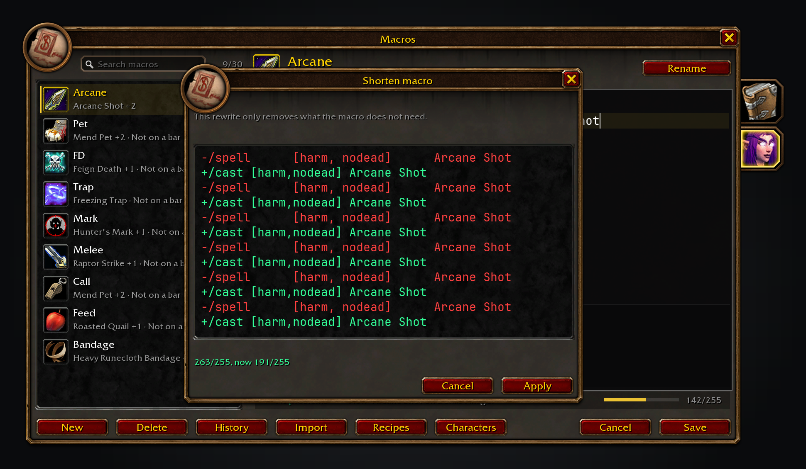

<h1 align="center">Macro Assist Forever</h1>

Give WoW: Forever a macro window of its own: every macro in one list, and a mono-font editor with live checks.

   

## Features

- **Every macro in one searchable list.** General and character tabs hang off the window's right edge, and each macro shows its icon, name and a summary of its main action with a count of other cases. The selected row has a soft gold fill and left bar, and the search box filters by name or summary. The header names the action bar slots the selected macro sits in and the key that presses each, and a macro on no bar is marked.
- **A real editor.** The macro text uses JetBrains Mono on a dark code panel, with a line-number gutter, a highlight on the current line, and colour for commands, conditions, units and spells.
- **A plain-English "What it does" panel.** The bottom of the code panel shows one row per click and modifier branch, read from the macro's own parse, and hides when there is nothing to explain.
- **Completions as you type.** Type `/` for a command, `[` for a condition, `@` for a unit or start a spell name. Up and Down move through them, Tab inserts one, and each suggestion shows its live value as a yes or no tag.
- **Recipes for your class, checked against your spellbook.** Typing `pet` or `heal mouseover` offers checked recipes in the completion list, with spell names in your client's language, and Tab inserts the whole macro. Recipes opens the same catalogue in a popup with the general and class macros beside a full preview; an unlearned spell greys its recipe with the client's level, and Import creates it through the checked path.
- **Live conditions and spells.** Condition values come from the game right now, and the spellbook supplies your spell names and ranks.
- **Problems with a fix.** A wavy underline marks text the game cannot run. Hover it for the explanation, then press Tab or click it to apply the fix.
- **A status bar that says what fires now.** It shows the first problem in full with Tab to fix, the action the first matching line would take with your current target, and the character count out of 255 with a meter.
- **An icon picker in the window.** Click the header icon or Rename and the code gives way to one grid: the macro's Automatic icon and the icons of what it casts first, then your spellbook, then every icon in the game. Search by icon or spell name, or filter by class, spell school or item slot. The name is editable in the header, a pick shows at once, and Save keeps it.
- **Rename, New, Save, Cancel and Delete.** Delete asks for a second click. New adds a macro and opens the picker with its name ready to type. Drag a row or the header icon onto an action bar to place it.
- **Import a macro by pasting it.** Addons cannot reach the web, so Import takes pasted text, checks it with the same parser and diagnostics as the editor, and refuses prose, MySlot exports and anything over 255 characters. A macro that passes opens the name and icon picker.
- **Copy a macro from another character.** Characters lists the other characters' macros and shows the differing lines before Keep both or Replace. Replace asks for a second click, and both are off in combat.
- **Shorten a macro that is over 255.** The status line offers Shorten when a lossless rewrite exists, the preview shows only the changed lines, and Apply puts the rewrite in the editor without saving. It trims redundant whitespace, uses each command's shortest alias, and drops clauses the checker calls unreachable.
- **History with Restore.** Every save, rename and delete keeps the previous name, icon and text, the newest 20 for each macro. History lists them with their time and what changed, and Restore puts one back. Deleted macros stay in a Deleted section until restored.
- **Safe to open in combat.** Every button that writes to your macros is off in combat, Restore included, with a line saying why. Edits are saved when the window closes out of combat.

The searchable macro list on the left, with the selected macro open in the editor on the right and the "What it does" panel below the code.

Conditions are offered with their live value, and a wavy underline marks a problem on the line above.

Typing plain words on a line offers checked recipes, with each spell name resolved in the client's language.

Recipes lists the general and class macros beside the whole macro; an unlearned spell is greyed with the client's level.

History keeps the previous versions of each macro, with a Deleted section for macros that can be restored.

Characters copies a macro from another character, showing the lines that differ before Keep both or Replace.

The icon picker: the macro's Automatic icon and what it casts, your spellbook, then every icon, with search and filters.

Paste a macro from wago.io or another character, see its checks and character count, then import it into the General or character tab.

An over-limit macro offers a lossless rewrite, shown as a diff before it reaches the editor.

## Install

Put the `MacroAssistForever` folder in `World of Warcraft/_forever_/Interface/AddOns`, or install it from CurseForge. Then type `/reload`.

## Usage

Open the macro window as you always do: `/macro`, `/m`, the game menu, or your keybind. `/macroassist` opens it too, and so does the addon compartment. Each one closes the window again when it is already open. The General tab holds account macros and the character tab holds this character's macros.

Click a macro to edit it, or type in the search box to narrow the list. New creates a macro and opens the icon picker with its name ready to type. Import checks pasted text and opens the same picker. Characters copies a macro from another character into the open tab. Recipes browses the general and class macros, and Import creates the one selected. Plain words such as `pet` or `heal mouseover` offer checked recipes in the completion list, which Tab turns into a whole macro. Rename opens the picker; Back to code returns to the editor. Cancel restores the saved text, Save writes immediately, and History restores an earlier version. Closing the window saves your text out of combat.

## Works alongside

Macro Assist Forever covers Blizzard's macro panel but leaves the panel, its keybind and macro store in place, and never runs macros for you.

## Development

Run `stylua --check .`, `luacheck .`, and every `tests/*_spec.lua` under LuaJIT. Render the screenshots with `python3 tools/screenshots.py`, then check them with `python3 tools/check_screenshots.py` and `python3 tools/visual_audit.py`.

## Support

The addon is free and stays GPL-3.0. If it saves you time, you can [sponsor me on GitHub](https://github.com/sponsors/cjber), which takes no fees, or [buy me a coffee on Ko-fi](https://ko-fi.com/cjber); nothing is locked behind it and there is no paid version.

## Credits

Thanks to the JetBrains Mono project for the bundled mono font, used under the SIL Open Font License, and to warcraft.wiki.gg for the macro conditional reference. [THIRD_PARTY.md](THIRD_PARTY.md) lists every input and its licence.

<!-- forever-credits:start -->

Thanks to Kal66 and everyone who reported a bug or asked for a feature.

<!-- forever-credits:end -->

## Licence

GPL-3.0-or-later. See [LICENSE](LICENSE). World of Warcraft is a trademark of Blizzard Entertainment, Inc. This addon is not affiliated with or endorsed by Blizzard Entertainment.

<!-- forever-family:start -->

## The Forever addons

Each one works on its own, and they work together when you install more than one.

| Addon | What it does | Issues |
|---|---|---|
| [Shortest Path Forever](https://www.curseforge.com/wow/addons/shortest-path-forever) | Plans journeys on foot, by air, by sea and through portals, with directions in the tracker. | [Issues](https://github.com/cjber/shortest-path-forever/issues) |
| [Adventure Guide Forever](https://www.curseforge.com/wow/addons/adventure-guide-forever) | Suggests quests for your level and routes you from one to the next. | [Issues](https://github.com/cjber/adventure-guide-forever/issues) |
| [SkillUp Forever](https://www.curseforge.com/wow/addons/skillup-forever) | Shows skill-up chances, recipe costs and levelling routes in the Professions window. | [Issues](https://github.com/cjber/skillup-forever/issues) |
| [Legacy Forever](https://www.curseforge.com/wow/addons/legacy-forever) | Shows your unfinished Legacy challenges on the world map and tracks the ones you choose. | [Issues](https://github.com/cjber/legacy-forever/issues) |
| [Tweaks Forever](https://www.curseforge.com/wow/addons/tweaks-forever) | Adds quest automation, rare alerts and merchant options to the game's settings. | [Issues](https://github.com/cjber/tweaks-forever/issues) |
| [Field Guide Forever](https://www.curseforge.com/wow/addons/field-guide-forever) | Keeps a cosmetic journal of the creatures you kill, zone by zone. | [Issues](https://github.com/cjber/field-guide-forever/issues) |
| [Commissions Forever](https://www.curseforge.com/wow/addons/commissions-forever) | Lists your commission turn-ins, the materials in your bags and the next NPC to visit. | [Issues](https://github.com/cjber/commissions-forever/issues) |
| [Macro Assist Forever](https://www.curseforge.com/wow/addons/macro-assist-forever) | Adds a macro window with every macro in one list, a mono editor with live checks, and history. | [Issues](https://github.com/cjber/macro-assist-forever/issues) |

Bug reports, feature requests and pull requests are welcome on each addon's GitHub. Everyone whose report or idea ships is thanked by name on the Thanks page in game, in the store page and in the changelog, unless they ask not to be.

For help, ideas and each day's release notes, join [cjber's Workshop on Discord](https://discord.gg/FpHugGxRJY).

<!-- forever-family:end -->
