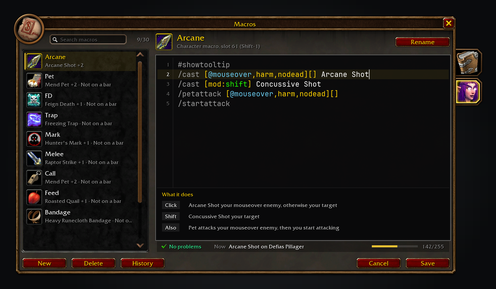
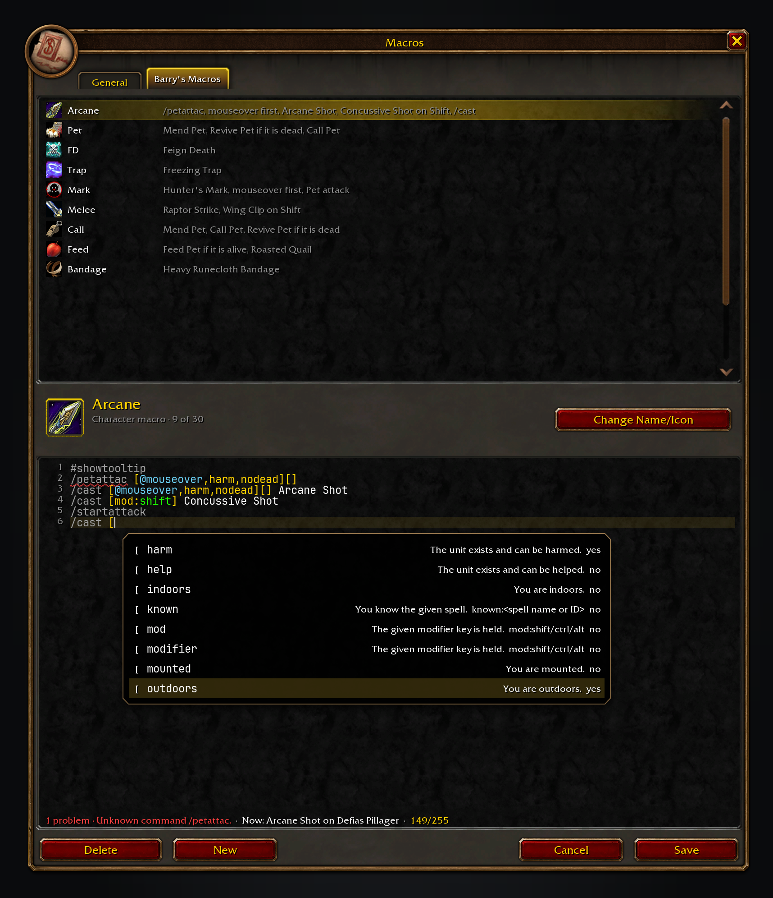
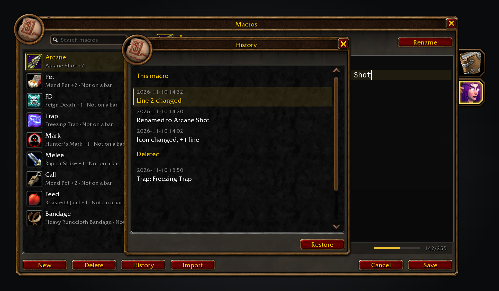
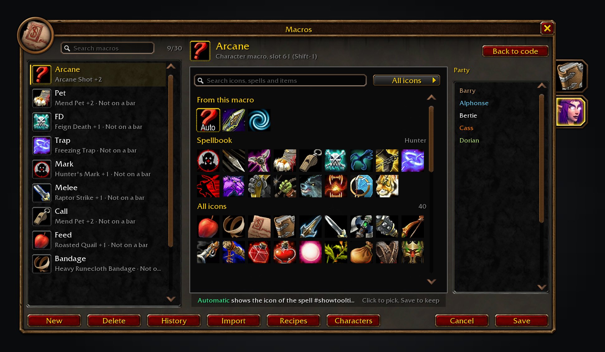

Macro Assist Forever gives WoW: Forever a macro window of its own. Blizzard's macro panel still opens; this addon puts every macro in one searchable list and opens the selected one in a mono-font editor beside it.

Free, with nothing locked behind it. If it saves you time, you can [sponsor me on GitHub](https://github.com/sponsors/cjber), which takes no fees, or [buy me a coffee on Ko-fi](https://ko-fi.com/cjber). For help and each day's release notes, [join me on Discord](https://discord.gg/FpHugGxRJY).

  

The searchable macro list on the left, with the selected macro open in the editor on the right and the "What it does" panel below the code.

Conditions are offered with their live value, and a wavy underline marks a problem on the line above.

History keeps the previous versions of each macro, with a Deleted section for macros that can be restored.

The icon picker: the macro's Automatic icon and what it casts, your spellbook, then every icon, with search and filters.

These images are generated previews of the Macro Assist UI.

## Features

- **Every macro in one searchable list.** General and character tabs hang off the window's right edge, as in the game's spellbook, and each macro shows its icon, name and a short summary of its main action with a count of the other cases. The count sits beside the search box, which filters by name or summary as you type.
- **A real editor.** The macro text uses JetBrains Mono on a dark code panel, with a line-number gutter, a current-line highlight, and colour for commands, conditions, units and spells.
- **A plain-English "What it does" panel.** The bottom of the code panel shows one row per click and modifier branch, read from the macro's own parse, and hides when there is nothing it can explain.
- **Completions with live values.** Type `/` for a command, `[` for a condition, `@` for a unit or a spell name; Up and Down move the suggestions, Tab inserts one, and each shows its value in the game right now. The spellbook supplies your spell names and the ranks you know.
- **Problems with a fix.** A wavy underline marks text the game cannot run: hover it for the explanation, then press Tab or click it to apply the suggested fix. The status bar shows the first problem, what the first matching line would do with your current target, and the character count out of 255.
- **Rename, New, Save, Cancel and Delete, with an icon picker in the window.** Rename or the header icon opens it: the macro's own icons first, then your spellbook and every icon, with search and filters by class, spell school or item slot. New opens it with the name ready to type, and Delete asks for a second click.
- **History with Restore.** Every save, rename and delete keeps the previous name, icon and text, the newest 20 for each macro, listed with their time and what changed. Restore puts one back, and deleted macros stay restorable in a Deleted section.
- **Safe to open in combat.** Every write is turned off in combat, Restore included, with a line saying why. Edits are saved when the window closes out of combat.

## Usage

Open the macro window as you always do: `/macro`, `/m`, the game menu, or your keybind. `/macroassist` opens it too, and so does the addon compartment. Each one closes the window again when it is already open. General holds account macros and the character tab holds this character's macros.

Click a macro to edit it, or type in the search box to narrow the list. New creates a macro and opens the icon picker with its name ready to type. Rename, or a click on the header icon, opens the picker; Back to code returns to the editor. Cancel puts the editor back to the saved text, and Save writes it immediately. History lists the macro's earlier versions, and Restore puts one back. Closing also saves your text out of combat.

For a bug report, paste `/macroassist report`.

<!-- forever-family:start -->

## The Forever addons

Each one works on its own, and they work together when you install more than one.

| Addon | What it does | Issues |
|---|---|---|
| [Shortest Path Forever](https://www.curseforge.com/wow/addons/shortest-path-forever) | Plans journeys on foot, by air, by sea and through portals, with directions in the tracker. | [Issues](https://github.com/cjber/shortest-path-forever/issues) |
| [Adventure Guide Forever](https://www.curseforge.com/wow/addons/adventure-guide-forever) | Suggests quests for your level and routes you from one to the next. | [Issues](https://github.com/cjber/adventure-guide-forever/issues) |
| [SkillUp Forever](https://www.curseforge.com/wow/addons/skillup-forever) | Shows skill-up chances, recipe costs and levelling routes in the Professions window. | [Issues](https://github.com/cjber/skillup-forever/issues) |
| [Legacy Forever](https://www.curseforge.com/wow/addons/legacy-forever) | Shows your unfinished Legacy challenges on the world map and tracks the ones you choose. | [Issues](https://github.com/cjber/legacy-forever/issues) |
| [Tweaks Forever](https://www.curseforge.com/wow/addons/tweaks-forever) | Adds quest automation, rare alerts and merchant options to the game's settings. | [Issues](https://github.com/cjber/tweaks-forever/issues) |
| [Field Guide Forever](https://www.curseforge.com/wow/addons/field-guide-forever) | Keeps a cosmetic journal of the creatures you kill, zone by zone. | [Issues](https://github.com/cjber/field-guide-forever/issues) |
| [Commissions Forever](https://www.curseforge.com/wow/addons/commissions-forever) | Lists your commission turn-ins, the materials in your bags and the next NPC to visit. | [Issues](https://github.com/cjber/commissions-forever/issues) |
| [Macro Assist Forever](https://www.curseforge.com/wow/addons/macro-assist-forever) | Adds a macro window with every macro in one list, a mono editor with live checks, and history. | [Issues](https://github.com/cjber/macro-assist-forever/issues) |

Bug reports, feature requests and pull requests are welcome on each addon's GitHub. Everyone whose report or idea ships is thanked by name on the Thanks page in game, in the store page and in the changelog, unless they ask not to be.

For help, ideas and each day's release notes, join [cjber's Workshop on Discord](https://discord.gg/FpHugGxRJY).

<!-- forever-family:end -->

<!-- forever-credits:start -->

Thanks to everyone who reports a bug or asks for a feature.

<!-- forever-credits:end -->

Source code and issues: [github.com/cjber/macro-assist-forever](https://github.com/cjber/macro-assist-forever). Licence: GPL-3.0-or-later.

Built with AI assistance.
